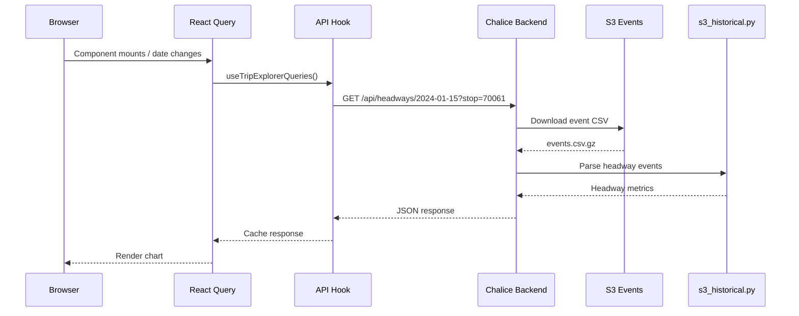
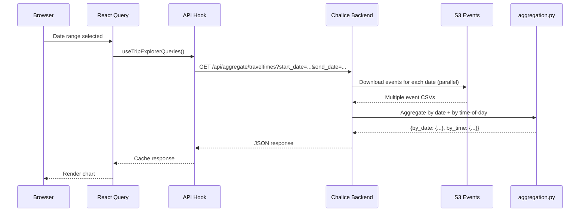
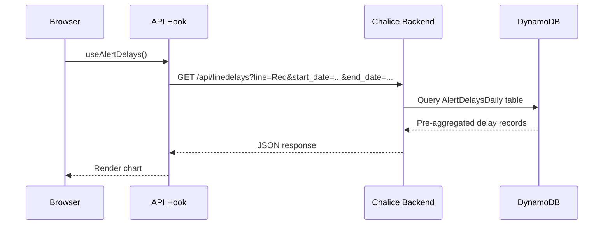
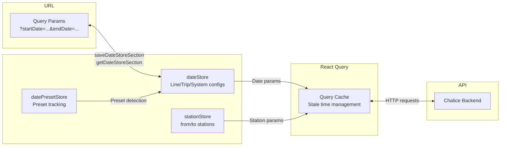
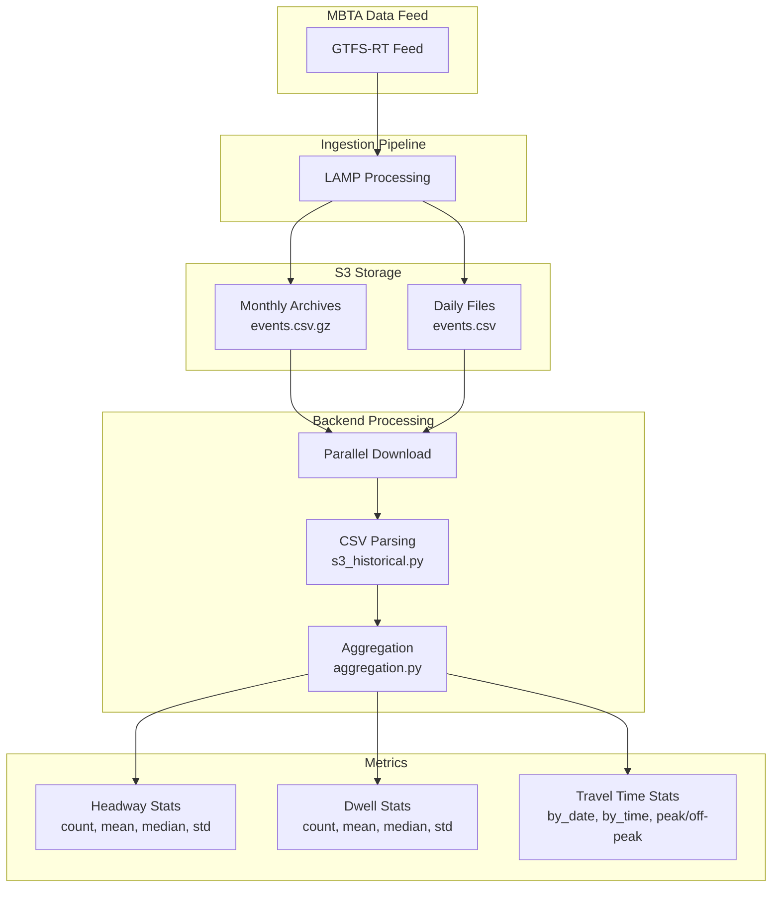

# Data Flow

## Request Lifecycle

### Single-Day Query

When a user views performance data for a specific date (e.g., headways at a station on 2024-01-15):

### Aggregate Query

When a user views aggregated data over a date range (e.g., travel times over 30 days):

### Pre-Aggregated Query

For line-level metrics (delays, trip metrics, ridership), data is pre-aggregated in DynamoDB:

## State Management Flow

### State Flow Details

1. **Page Load**: URL query params are parsed and used to initialize Zustand stores via `LoadPresetsLayout`
2. **User Interaction**: Date pickers and station selectors update Zustand stores
3. **Store Update**: Store changes trigger `saveDateStoreSection()` which updates URL query params
4. **Query Invalidation**: React Query hooks depend on store values — when they change, queries re-fetch
5. **Caching**: React Query caches responses with configurable stale times (1 min for alerts, 1 hour for schedules)

## Data Pipeline

### Raw Events to Metrics

### Event CSV Format

Each event file contains arrival and departure records:

| Column | Description |
|--------|-------------|
| `event_type` | `ARR` (arrival) or `DEP` (departure) |
| `trip_id` | GTFS trip identifier |
| `event_time` | Unix timestamp of the event |
| `service_date` | Service date (transit day, offset by 3:30am) |

### Metric Calculations

- **Headways**: Time between consecutive departures at a stop
- **Dwells**: Time between arrival and departure of the same trip at a stop
- **Travel Times**: Time between arrivals at two different stops for the same trip
- **Peak Detection**: Non-holiday weekdays, 6:30-9:00am or 3:30-6:30pm

## Caching Strategy

### Backend Cache Headers

| Data Recency | Cache Duration | Rationale |
|-------------|---------------|-----------|
| Today | 15 minutes (900s) | Data still updating from live feed |
| < 6 months | 1 hour (3600s) | Stable but may receive corrections |
| > 6 months | 3 months (7,776,000s) | Historical data, unlikely to change |

### Frontend Cache (React Query)

| Data Type | Stale Time | Rationale |
|-----------|-----------|-----------|
| Alerts | 1 minute | Real-time data, changes frequently |
| Accessibility alerts | 1 minute | Elevator/escalator status changes |
| Historical alerts | 5 minutes | Past alerts, stable |
| Scheduled service | 1 hour | Schedule changes are infrequent |
| Default | 10 seconds | General data freshness |
