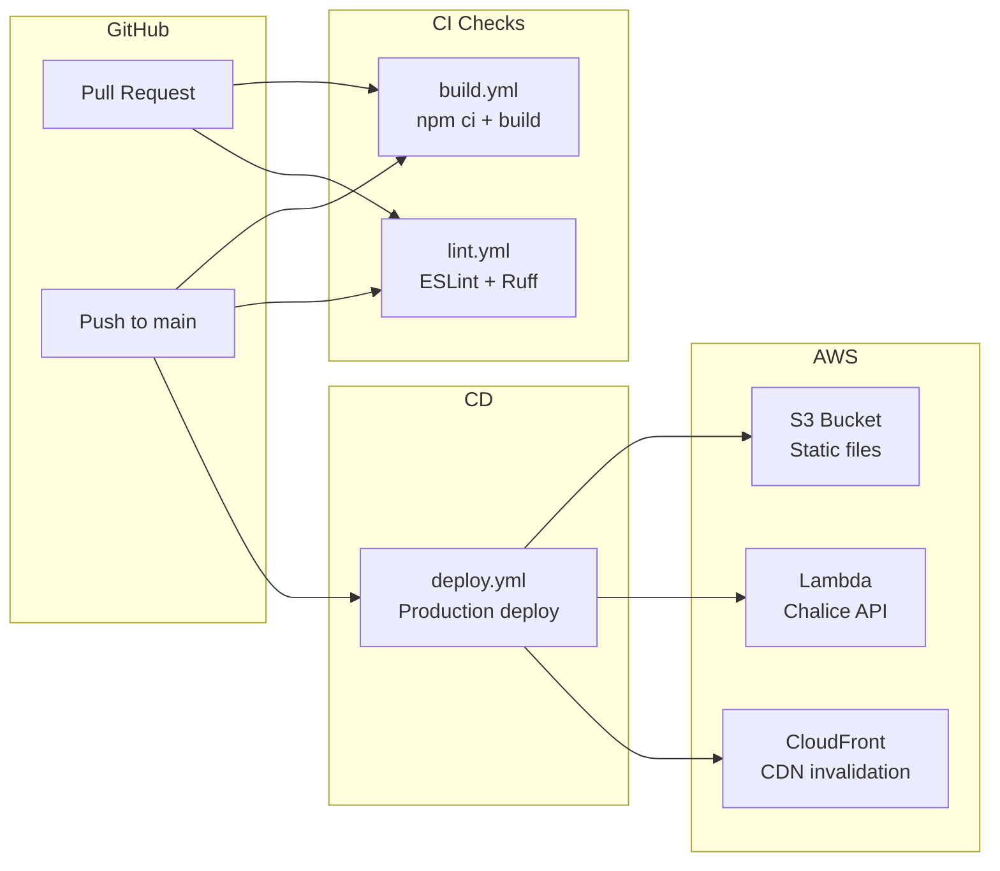

# Deployment

## Environments

| Environment | Frontend URL | Backend URL | Trigger |
|------------|-------------|-------------|---------|
| Beta | `labs.transitmatters.org/dashboard-beta.*` | Beta API Gateway | `./deploy.sh` |
| Production | `dashboard.transitmatters.org` | `dashboard-api.labs.transitmatters.org` | `./deploy.sh -p` or push to `main` |

## CI/CD Pipeline

### GitHub Actions Workflows

#### `build.yml` — Build Verification
- **Triggers**: Pull requests, pushes to `main`
- **Matrix**: Node 24, Python 3.12
- **Steps**: Checkout, setup Python + uv + Node, verify `package-lock.json`, run `npm ci && npm run build`

#### `lint.yml` — Code Quality
- **Triggers**: Pull requests, pushes to `main`
- **Jobs**:
    - Frontend: `npm run lint-frontend` (TypeScript + ESLint)
    - Backend: `npm run lint-backend` (Ruff check + format verification)

#### `deploy.yml` — Production Deployment
- **Triggers**: Manual dispatch, monthly cron (1st of month), push to `main`
- **Secrets**: AWS credentials, ACM certificate ARNs, API keys
- **Steps**: Checkout, setup environment, generate AWS profile, run `bash deploy.sh -p -c`

#### Other Workflows
- `first-interaction.yml` — Welcome message for new contributors
- `healthcheck.yml` — API health status checks
- `label.yml` — Auto-labeling pull requests
- `stale-bot.yml` — Closes inactive issues/PRs

## Deployment Script (`deploy.sh`)

### Required Environment Variables

| Variable | Purpose |
|----------|---------|
| `MBTA_V3_API_KEY` | MBTA API access key |
| `DD_API_KEY` | Datadog monitoring key |
| `TM_FRONTEND_CERT_ARN` or `TM_LABS_WILDCARD_CERT_ARN` | AWS ACM certificate for HTTPS |

### Flags

| Flag | Purpose |
|------|---------|
| `-p` | Deploy to production (default: beta) |
| `-c` | CI mode (non-interactive) |

### Deployment Steps

1. **Build frontend**: `npm run build` — produces static export in `out/`
2. **Package constants**: Copies `common/constants/*.json` to `server/chalicelib/` for Lambda packaging
3. **Export Python deps**: Generates `requirements.txt` from `uv` lock file
4. **Chalice package**: Bundles Lambda deployment package
5. **CloudFormation deploy**: Deploys infrastructure with parameter overrides
6. **S3 sync**: Uploads static files with cache headers:
    - `index.html`: `no-cache` (always revalidate)
    - All other files: `max-age=31536000, immutable` (1 year)
7. **Redirect pages**: Syncs V3-to-V4 redirect HTML for `/rapidtransit`, `/bus`, `/slowzones`
8. **CloudFront invalidation**: Clears CDN cache

### Cache Headers

| File Type | Cache-Control | Rationale |
|-----------|--------------|-----------|
| `index.html` | `no-cache` | Entry point must always be fresh |
| JS/CSS/assets | `max-age=31536000, immutable` | Content-hashed filenames ensure freshness |

## Infrastructure

### AWS Resources

| Resource | Service | Purpose |
|----------|---------|---------|
| Static site | S3 + CloudFront | Serve frontend assets |
| API | API Gateway + Lambda | Serve backend API |
| Event data | S3 (`tm-mbta-performance`) | Raw transit event CSVs |
| Metrics | DynamoDB (8+ tables) | Pre-aggregated performance data |
| Monitoring | Datadog | APM and error tracking |
| Certificates | ACM | HTTPS termination |

### Monitoring

- **Datadog Lambda integration**: Enabled in production via `datadog_lambda` package
- **Git version tagging**: Each deployment is tagged with the git commit SHA
- **Healthcheck endpoint**: `GET /api/healthcheck` verifies API key and S3 connectivity
