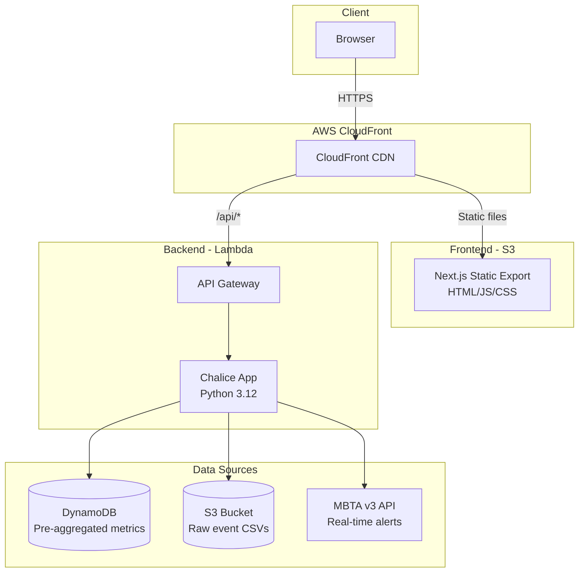
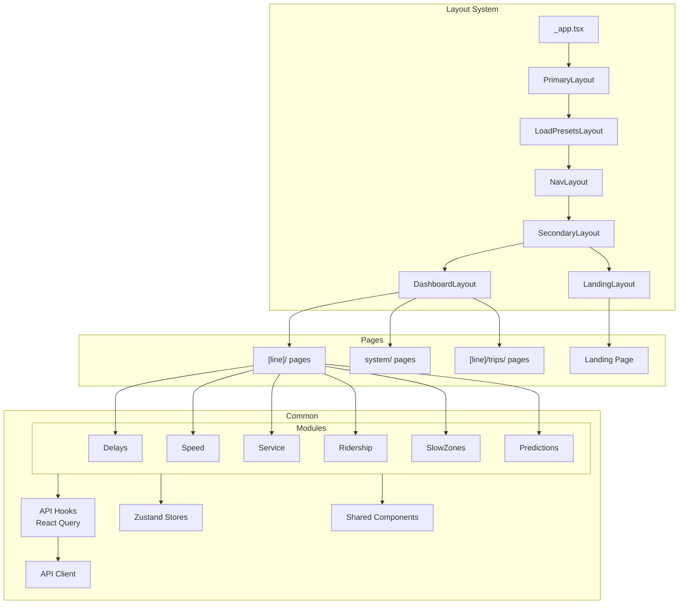
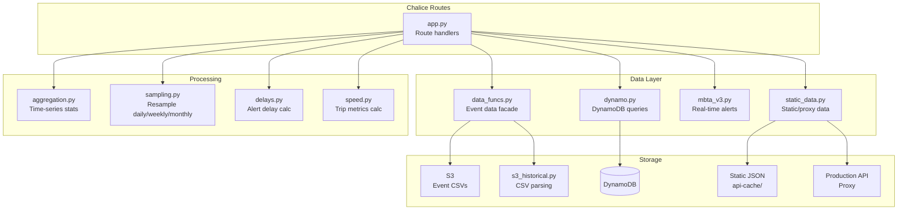

# Architecture Overview

The Data Dashboard is a **static-site + serverless** architecture. The frontend is a Next.js static export served via S3 and CloudFront. The backend is an AWS Chalice (Python) application deployed as Lambda functions behind API Gateway.

## System Architecture

## Frontend Architecture

The frontend follows a **module-based architecture** where each feature area (delays, headways, speed, etc.) is a self-contained module with its own components.

## Backend Architecture

The backend uses a facade pattern — `data_funcs.py` and `static_data.py` abstract the data source, allowing the same API routes to work against AWS services, cached static files, or a production proxy.

## Key Design Decisions

### Static Export + Serverless
The frontend uses `next export` to produce a fully static site. There is no server-side rendering — all data fetching happens client-side via React Query. This allows the frontend to be served entirely from S3/CloudFront with no compute costs.

### Three Backend Modes
The backend can run in three modes controlled by `TM_BACKEND_SOURCE`:

| Mode | Use Case | Data Source |
|------|----------|-------------|
| `aws` | Production / full local dev | DynamoDB + S3 (requires AWS credentials) |
| `prod` | Local dev without AWS | Proxies requests to production API |
| `static` | Offline / CI | Cached JSON files in `public/static/api-cache/` |

### Module Isolation
Each feature (delays, headways, speed, etc.) lives in its own `modules/` directory with components that are only used by that feature. Shared infrastructure lives in `common/`.

### URL-Driven State
Date ranges and station selections are persisted in URL query parameters. This allows users to share links to specific views and enables browser back/forward navigation through state changes.
