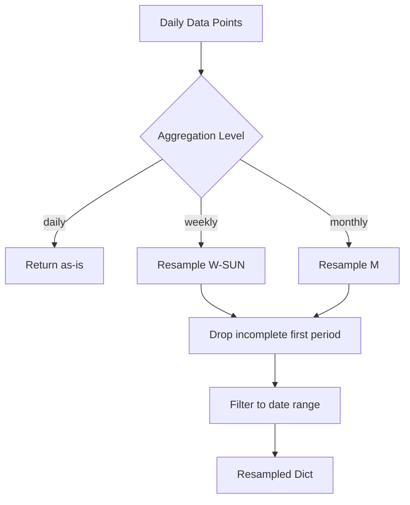

# Data Processing

The backend processes raw transit events into performance metrics through several stages: event parsing, aggregation, and resampling.

## Event Parsing (`s3_historical.py`)

Raw CSV event files contain arrival (`ARR`) and departure (`DEP`) records. These are parsed into three types of metrics:

### Headways

Time between consecutive departures at a stop.

```
DEP trip_A at 08:00 → DEP trip_B at 08:05 → headway = 5 minutes
```

::: server.chalicelib.s3_historical.headways
    options:
      show_source: false

### Dwells

Time a train spends stopped at a station (arrival to departure of the same trip).

```
ARR trip_A at 08:00 → DEP trip_A at 08:01 → dwell = 1 minute
```

::: server.chalicelib.s3_historical.dwells
    options:
      show_source: false

### Travel Times

Time to travel between two stops (departure-to-arrival for the same trip).

```
DEP trip_A at stop_1 08:00 → ARR trip_A at stop_2 08:15 → travel_time = 15 minutes
```

::: server.chalicelib.s3_historical.travel_times
    options:
      show_source: false

---

## Time-Series Aggregation (`aggregation.py`)

### Transit Day Offset

The transit service day does not align with the calendar day. The system applies a **3 hour 30 minute offset** — a service date runs from approximately 3:30am to 3:30am the next day.

```python
SERVICE_HR_OFFSET = datetime.timedelta(hours=3, minutes=30)
```

### Peak Period Classification

Trips are classified as peak or off-peak:

| Period | Hours | Days |
|--------|-------|------|
| AM Peak | 6:30 AM – 9:00 AM | Non-holiday weekdays |
| PM Peak | 3:30 PM – 6:30 PM | Non-holiday weekdays |
| Off-Peak | All other times | All days, plus holidays |

::: server.chalicelib.aggregation.train_peak_status
    options:
      show_source: false

### Statistical Aggregation

A high-performance replacement for pandas `describe()` that computes count, mean, std (population), min, 25th/50th/75th percentiles, max, and sum. Groups with fewer than 5 observations are excluded.

::: server.chalicelib.aggregation.faster_describe
    options:
      show_source: false

### Travel Time Aggregation

::: server.chalicelib.aggregation.travel_times_all
    options:
      show_source: false

::: server.chalicelib.aggregation.travel_times_over_time
    options:
      show_source: false

::: server.chalicelib.aggregation.calc_travel_times_by_date
    options:
      show_source: false

::: server.chalicelib.aggregation.calc_travel_times_by_time
    options:
      show_source: false

### Headway Aggregation

In addition to standard statistics, headway aggregation calculates:

| Metric | Definition |
|--------|------------|
| Bunching ratio | Headway ≤ 50% of scheduled headway |
| On-time ratio | Headway between 75%–125% of scheduled |

::: server.chalicelib.aggregation.headways_over_time
    options:
      show_source: false

### Dwell Aggregation

::: server.chalicelib.aggregation.dwells_over_time
    options:
      show_source: false

---

## Resampling (`sampling.py`)

Converts daily data points to weekly or monthly aggregates.

::: server.chalicelib.sampling.resample_and_aggregate
    options:
      show_source: false



::: server.chalicelib.sampling.resample_list_of_values_with_range
    options:
      show_source: false

---

## Parallel Processing (`parallel.py`)

::: server.chalicelib.parallel.make_parallel
    options:
      show_source: false

Used primarily for:

- Downloading multiple event files from S3
- Querying multiple DynamoDB tables concurrently

---

## Line Metrics Processing

### Alert Delays (`delays.py`)

::: server.chalicelib.delays.delay_time_by_line
    options:
      show_source: false

### Trip Metrics (`speed.py`)

::: server.chalicelib.speed.trip_metrics_by_line
    options:
      show_source: false

::: server.chalicelib.speed.aggregate_actual_trips
    options:
      show_source: false

### Service Hours (`service_hours.py`)

::: server.chalicelib.service_hours.get_service_hours
    options:
      show_source: false

::: server.chalicelib.service_hours.get_delivered_service_times
    options:
      show_source: false

---

## Date Utilities (`date_utils.py`)

::: server.chalicelib.date_utils.parse_event_date
    options:
      show_source: false

::: server.chalicelib.date_utils.get_max_monthly_data_date
    options:
      show_source: false

### S3 Date Range (`parallel.py`)

::: server.chalicelib.parallel.s3_date_range
    options:
      show_source: false
