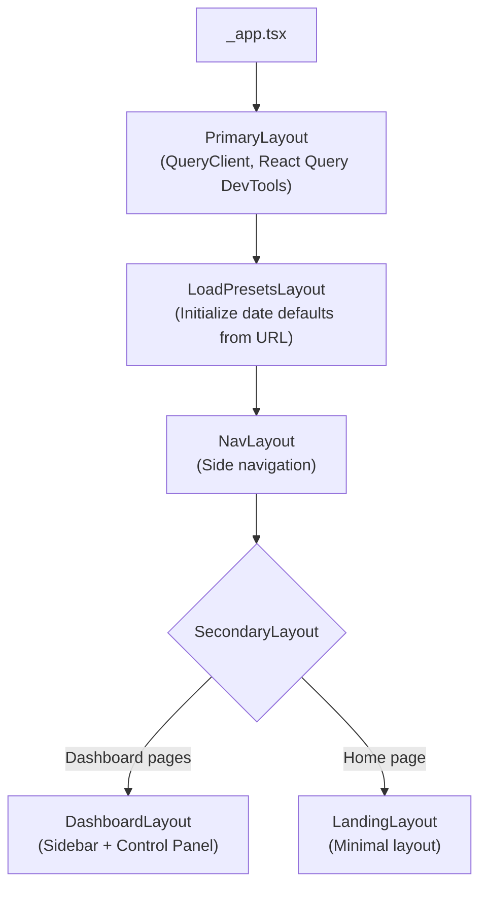

# Frontend Overview

The frontend is a Next.js 15 application with React 18 and TypeScript. It uses static export (`next export`) — there is no server-side rendering. All data fetching happens client-side through React Query hooks.

## Architecture

```
common/
├── api/              # API client functions + React Query hooks
├── components/       # Shared UI components (charts, widgets, inputs)
├── constants/        # Colors, dates, station data, line configs
├── layouts/          # Layout components (Dashboard, Landing, Nav)
├── state/            # Zustand stores (dates, stations, presets)
├── types/            # TypeScript type definitions
└── utils/            # Utility functions
modules/              # Feature modules (self-contained per feature)
pages/                # Next.js pages (routing)
```

## Layout System

Pages are rendered inside a nested layout composition:



Each page component declares its layout via a static `Layout` property:

```typescript
// pages/[line]/index.tsx
OverviewPage.Layout = Layout.Dashboard;
```

## Key Patterns

### Module-Based Organization
Each feature area (delays, headways, speed, etc.) is a self-contained module in `modules/`. Modules contain their own components and import shared infrastructure from `common/`.

### Data Fetching
All API calls use React Query hooks from `common/api/hooks/`. This provides:

- Automatic caching with configurable stale times
- Loading and error state management
- Background refetching

### URL-Driven State
Date ranges and view options are persisted in URL query parameters, enabling shareable links and browser history navigation. Zustand stores sync bidirectionally with URL params.

### Responsive Design
The app uses:

- Separate `Desktop*` and `Mobile*` component variants
- A `useBreakpoint()` hook for programmatic breakpoint detection
- Tailwind CSS responsive utilities

## Chart.js Setup

Chart.js is initialized in `_app.tsx` with these plugins:

- `BarElement`, `LineElement` — basic chart types
- `Filler` — area fills
- `annotationPlugin` — reference lines and regions
- `ChartDataLabels` — data value labels

The primary charting component is `TimeSeriesChart` in `common/components/charts/TimeSeriesChart/`.

## Key Dependencies

| Package | Purpose |
|---------|---------|
| `next` 15 | Framework, routing, static export |
| `react` 18 | UI rendering |
| `zustand` | Client state management |
| `@tanstack/react-query` 5 | Server state (data fetching + caching) |
| `tailwindcss` 3.4 | Utility-first CSS |
| `chart.js` | Data visualization |
| `@fortawesome/react-fontawesome` | Icons |
| `dayjs` / `date-fns` | Date manipulation |
| `@transitmatters/stripmap` | Transit strip map component |
