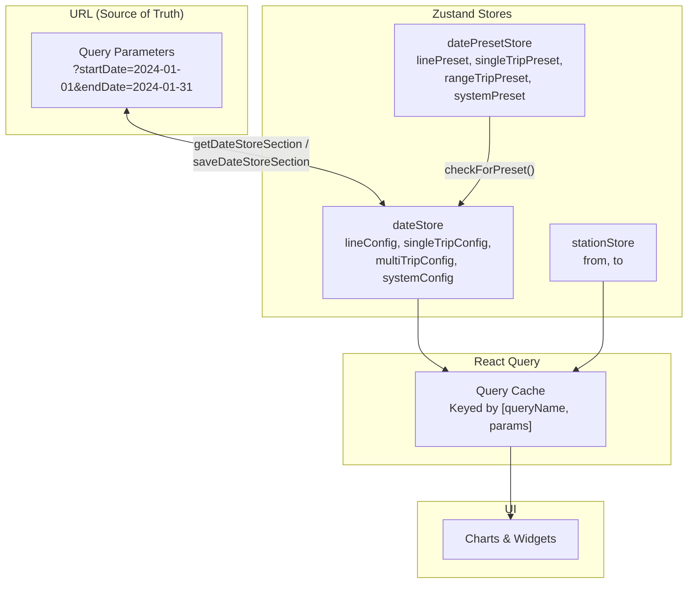

# State Management

The application uses [Zustand](https://github.com/pmndrs/zustand) for client state and [TanStack React Query](https://tanstack.com/query) for server state (API data caching).

## State Flow



## Zustand Stores

### `dateStore` (`common/state/dateStore.ts`)

Manages date range selections across different page sections.

```typescript
interface DateStore {
  lineConfig: LineSectionParams;         // Line dashboard date range
  singleTripConfig: SingleTripsSectionParams; // Single-day trip explorer
  multiTripConfig: MultiTripsSectionParams;  // Multi-day trip explorer
  systemConfig: SystemSectionParams;      // System-level pages
  overviewPreset: OverviewPresetParams;   // Overview preset (year, month, etc.)

  setLineConfig(config: LineSectionParams): void;
  setSingleTripConfig(config: SingleTripsSectionParams): void;
  setMultiTripConfig(config: MultiTripsSectionParams): void;
  overviewPresetChange(config: OverviewPresetParams): void;
  swapDashboardTabs(newTab: Tab): void;
}
```

**Key behavior**:

- `overviewPresetChange()` updates both the preset and the line config dates simultaneously — setting `endDate` to today and `startDate` based on the selected preset
- Each section config (line, singleTrip, multiTrip, system) stores `startDate` and `endDate` as strings

### `stationStore` (`common/state/stationStore.ts`)

Manages station selection for trip explorer pages.

```typescript
interface StationStore {
  from?: string;  // Origin station identifier
  to?: string;    // Destination station identifier
  setStationStore(from: string, to: string): void;
}
```

### `datePresetStore` (`common/state/datePresetStore.ts`)

Tracks which date preset is active for each page section.

```typescript
interface DatePresetStore {
  linePreset: DatePresetKey | 'custom';
  singleTripPreset: DatePresetKey | 'custom';
  rangeTripPreset: DatePresetKey | 'custom';
  systemPreset: DatePresetKey | 'custom';

  setDefaults(): void;    // Initialize from URL query params
  setDatePreset(section: string, preset: DatePresetKey | 'custom'): void;
}
```

**Date preset keys**: `'7d'`, `'30d'`, `'90d'`, `'1y'`, `'all'`, or `'custom'`.

---

## URL Synchronization

### Saving to URL (`utils/dateStoreUtils.ts`)

```typescript
saveDateStoreSection(section, params)
// Updates URL query params: ?startDate=...&endDate=...
```

Called whenever a Zustand store updates to keep the URL in sync.

### Loading from URL

```typescript
getDateStoreSection(section)
// Reads URL query params and returns date config
```

Called during page initialization in `LoadPresetsLayout`.

### Preset Detection (`utils/datePresetUtils.ts`)

```typescript
checkForPreset(startDate, endDate)
// Returns DatePresetKey if the range matches a known preset, or 'custom'
```

---

## Date Preset Configuration

Presets are defined in `common/constants/dates.ts`:

```typescript
OVERVIEW_OPTIONS = {
  week: { startDate: /* 7 days ago */ },
  month: { startDate: /* 30 days ago */ },
  year: { startDate: /* 1 year ago */ },
}
```

---

## React Query Integration

Hooks from `common/api/hooks/` use Zustand store values as query parameters:

```typescript
// Example: useAlertDelays reads date range from the store
const { lineConfig } = useDateStore();
const delays = useAlertDelays({
  line: lineShort,
  start_date: lineConfig.startDate,
  end_date: lineConfig.endDate,
  agg: 'daily',
});
```

When store values change, React Query automatically re-fetches data because the query key changes.
